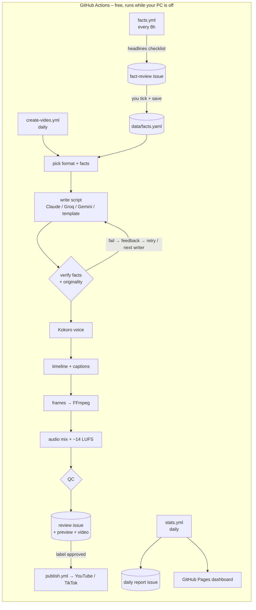

# Architecture

## Overview

The repo is the database. `data/` holds JSON/YAML files that the workflows commit back after each run:

| File | What |
|---|---|
| `data/facts.yaml` | The verified knowledge base, with sources, status and freshness |
| `data/videos.json` | Every video: script, facts used, style, QC result, status, platform ids |
| `data/usage.json` | Daily counters for free-tier quotas |
| `data/stats/*.json` | Daily platform statistics snapshots |
| `data/reports/*.md` | Daily reports |
| `data/fact_candidates.json` | News headlines awaiting or after review |

Video files are never committed. They live as Actions artifacts for 30 days, plus a "review-queue" release while waiting for review.

## Modules (`shorts/`)

| Module | Job |
|---|---|
| `facts.py` | Load/validate facts, freshness, derived facts (days until/since launch) |
| `topics.py` | 9 formats; picks a plan that is timely, novel and not the same format twice in a row |
| `writer/` | Provider chain: `claude_cli` (Claude Code + your Pro token), `groq`, `gemini` (OpenAI-compatible), `template` (offline). Every draft is verified; errors are fed back for a retry |
| `verify.py` | Claim grounding: unknown/stale facts, numbers not in the cited facts, uncited claims, rumour labelling, attribution of reported claims, myth framing, title rules, banned phrases |
| `originality.py` | Word-trigram similarity vs. the last 60 scripts, hook cooldown, format streaks |
| `voice/` | Kokoro (production) and Flite (test) engines, text normalisation ("$79.99" → "seventy-nine ninety-nine"), word timing |
| `timeline.py` | Sentence-level synthesis, frame-aligned scenes, caption chunks, SRT |
| `render/` | Original backgrounds (synth grid, aurora, skyline, stripes), text/badges/captions, compositor, one-file-per-scene encoding, concat, mux |
| `audio/` | Narration placement, synthesised SFX, procedural music with ducking, voice EQ/compression, 2-pass loudnorm |
| `qc.py` | ffprobe/ffmpeg measurements: format, duration, loudness, true peak, silence, black frames, caption coverage, hook timing, A/V length |
| `publish/` | Single publish gate, metadata with sources and disclosures, YouTube client (resumable upload, stats, analytics), TikTok client (inbox/direct) |
| `analytics/`, `dashboard.py`, `usage.py` | Stats snapshots, daily report, dashboard data, quota meters |
| `research.py` | RSS discovery, claim drafting, fact-review issue round trip |

## Key decisions

- **Original visuals only.** Rockstar's video policy covers occasional, *non-commercial* fan use of game footage, and it doesn't address trailers or artwork. An automated, monetisable channel doesn't fit that, so every frame is generated by code. Gameplay you record yourself after launch could be added later. See CONTENT_POLICY.md.
- **Facts DB as the single source of truth.** LLMs only rephrase supplied facts. The verifier rejects anything else, so a hallucination can't reach a video.
- **One frame renderer in Python, FFmpeg for encoding.** Full control of animation and captions (no libass/font issues). Each scene is encoded as one file with identical settings, then joined losslessly, so there is only one encode per frame.
- **Kokoro-82M via ONNX.** Apache-2.0 weights, good expressiveness, runs on the CPU of a free runner. Flite exists only so tests and emergencies work offline, and the publish gate refuses Flite videos.
- **GitHub issues as the control panel.** Approval, rejection, fact review and reports all work from the GitHub mobile app, need no extra service, and leave an audit trail.
- **Variety by construction.** 9 formats × 5 palettes × 4 backgrounds × 3 caption styles × 4 transitions × 2 headline styles, seeded per video, never repeating the previous combo. Add LLM-written scripts with hook cooldowns and procedural music that changes key and tempo.

## Possible next steps

- Your own gameplay clips: drop recordings into a folder and the pipeline cuts them into backgrounds (allowed for *your own* captures under Rockstar's policy, but the commercial use question still applies).
- Free stock B-roll (Pexels/Pixabay API, free keys) for real-world Miami/Florida comparison shots, with attribution in descriptions.
- Learning loop: feed approval/rejection comments and view stats back into the format weights.
